<!-- Cards: animated SVGs drawn by docs/render.py. Screenshots: the app's demo mode (docs/demo), with made-up people and messages.
     Keep the card blocks free of blank lines and each row's images on one line, so the tiles sit side by side. -->
<div align="center">
<br>
<br>
<br>
<picture><source media="(prefers-color-scheme: dark)" srcset="./docs/cards/title-look-dark.svg" /></picture><br>
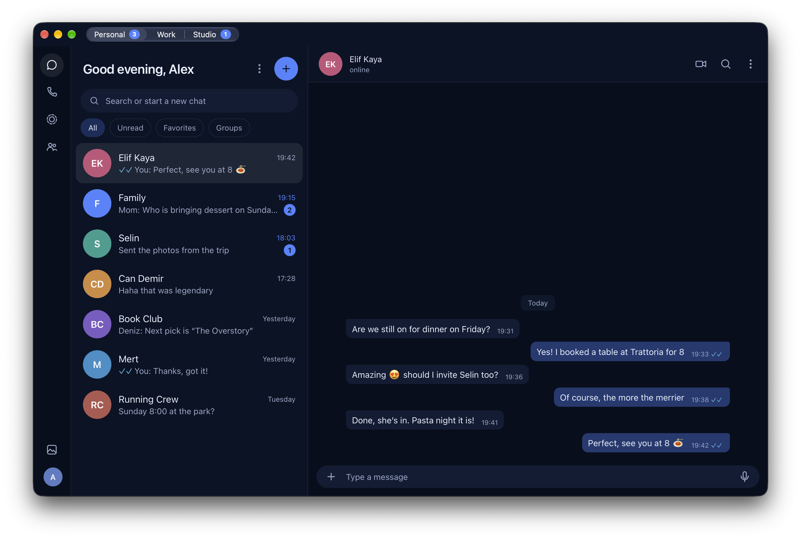<br>
<br>
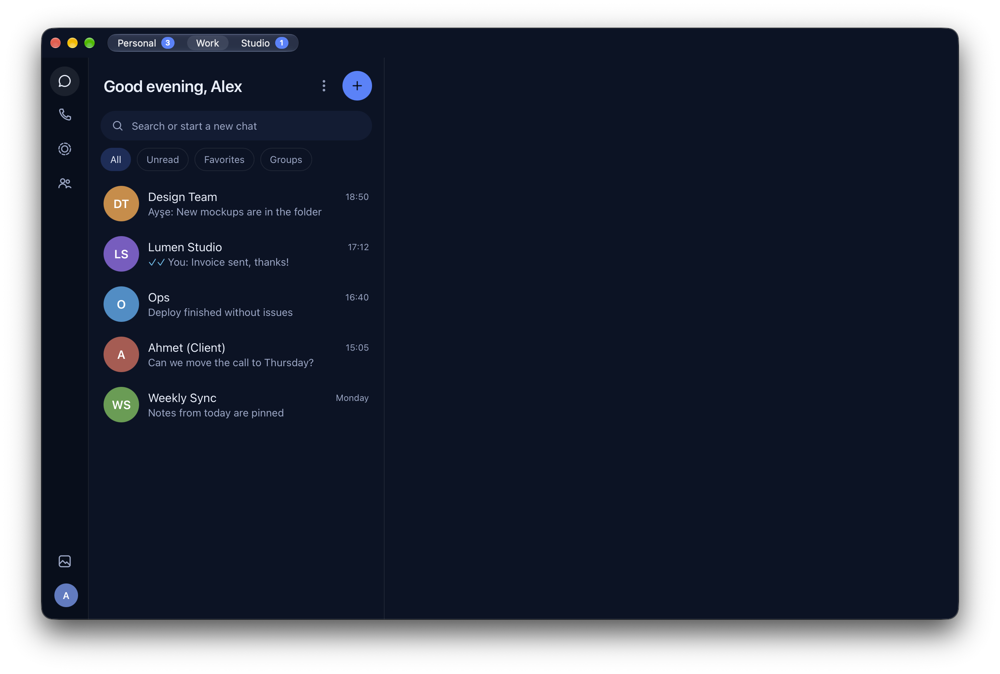
</div>

<p align="center"><sub>Screenshots come from the app's demo mode: the people and messages are made up.</sub></p>

<picture><source media="(prefers-color-scheme: dark)" srcset="./docs/cards/title-setup-dark.svg" /></picture>

**You need** macOS 15 Sequoia or later (the Liquid Glass look comes with macOS 26 and later) and Xcode or its Command Line Tools (`xcode-select --install`).

```sh
git clone https://github.com/KaanPehlivan/whatsapp-plus-mac.git
cd whatsapp-plus-mac
./build.sh
```

`build.sh` compiles `main.swift`, draws the icon, signs the app and installs `/Applications/WhatsApp+.app`. Then:

1. Open **WhatsApp+** and allow notifications when macOS asks.
2. On your phone, open WhatsApp → **Settings → Linked Devices → Link a Device** and scan the QR code. You stay logged in from then on.

> **Signing.** With an Apple Development certificate in your keychain, macOS remembers the notification and microphone permissions across rebuilds. Without one the app is signed ad hoc, and macOS may ask again after each rebuild.

<picture><source media="(prefers-color-scheme: dark)" srcset="./docs/cards/title-use-dark.svg" /></picture>

<p align="center">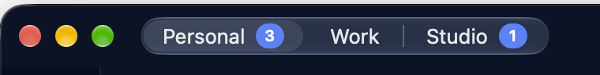</p>

### Numbers

| To | Do this |
| --- | --- |
| Add a number (up to 3) | Click **+** in the title bar, or **Account → Add Account…** (⇧⌘N) |
| Switch numbers | Click its name, or press ⌘1, ⌘2, ⌘3 |
| Rename or remove one | Right-click its name, or use the **Account** menu |

Each number logs in separately and keeps its own storage on your Mac. Removing a number asks first, then deletes its data from this Mac; remove it on your phone under **Linked Devices** too.

### Unread messages and notifications

- The blue badge next to a name counts that number's unread chats. The Dock shows the total.
- Every new message shows a macOS banner, with the number's name under the sender. Clicking it opens that chat on the right number.
- If WhatsApp+ isn't in front, the Dock icon bounces once.
- Numbers you're not looking at keep running in the background, so their messages still arrive.

### Chats

- Click the chat that's open to close it again (the same as pressing Esc).
- With no chat open, the right side stays blank navy.
- The header greets you by the first name of your Mac account, and changes with the time of day.
- Downloads go to `~/Downloads` and never overwrite a file. Links open in your browser. ⌘R reloads.
- Voice messages use the microphone; macOS asks once.

### What's hidden

The Channels and Meta AI buttons, the promo cards on the start screen, the "Get WhatsApp for Mac" bars and the download card on the login screen. Everything else is WhatsApp Web as usual.

The Channels button is matched by its label, so it's hidden when WhatsApp is in English or Turkish. For another language, add its label to the rule in `navy.css`.

### Make it yours

| Change | Where |
| --- | --- |
| Colors | The top block of `navy.css` maps WhatsApp's color names (`--WDS-*`) to the palette. |
| What's hidden | The rules at the bottom of `navy.css`. Delete a rule to bring that part back. |
| Greeting | `greet` in `main.swift`, or delete its rule in `navy.css`. |
| Icon | Edit `icon.svg`. For a personal icon that stays out of git, add `icon-local.svg`. Delete `AppIcon.icns` so it's redrawn. |
| Name | `CFBundleName` and `CFBundleDisplayName` in `Info.plist`. Don't change `CFBundleIdentifier`: the logins are tied to it. |

Run `./build.sh` after any change.

### When WhatsApp updates

WhatsApp Web changes now and then. If a grey or green patch or a hidden button comes back, quit WhatsApp+ (⌘Q) and run the self-test:

```sh
NAVY_SELFTEST=1 "/Applications/WhatsApp+.app/Contents/MacOS/WhatsApp+"
```

It checks the theme and posts a "Self-test" banner to check notifications. Then every 20 seconds it prints each number's page title and unread count, and lists any background that isn't navy, by element type only (never message text). To look closer, open Safari → **Develop → WhatsApp+**.

### Demo mode

Quit WhatsApp+ (⌘Q) first, then:

```sh
WAPLUS_DEMO="$PWD/docs/demo" WAPLUS_DEMO_SHOW=0 "/Applications/WhatsApp+.app/Contents/MacOS/WhatsApp+"
```

Shows made-up chats in three throwaway numbers instead of WhatsApp (`WAPLUS_DEMO_SHOW` picks which one is in front). Your real logins, saved numbers and window position aren't touched; the demo posts one sample notification, which stays in Notification Center. The cards above are drawn by `python3 docs/render.py`.

### Troubleshooting

- **No banners:** System Settings → Notifications → WhatsApp+ → Allow notifications.
- **Blank page or "update your browser":** press ⌘R. WhatsApp+ identifies itself as your Mac's Safari, so keeping macOS up to date helps.
- **Old icon in the Dock:** quit WhatsApp+, run `killall Dock` and open it again.
- **Calls:** voice and video calls depend on WhatsApp Web's support inside a web view. If one doesn't connect, take it on your phone.

### How it works

One Swift file, `main.swift`: an AppKit window with one `WKWebView` per number, each with its own persistent `WKWebsiteDataStore`. When a page starts, the app adds `navy.css` and a small script: a `Notification` shim that hands messages to macOS notifications, the greeting, and click-to-close. Unread counts come from the page title. WhatsApp's own code is never changed.

### Privacy

No analytics and no network traffic of its own: the only connection is WhatsApp Web itself. Logins and data stay on your Mac in `~/Library/WebKit/com.kaan.whatsapp-navy/` (one store per number), `~/Library/Caches/com.kaan.whatsapp-navy/` and `~/Library/HTTPStorages/`, and the list of numbers in the app's macOS preferences.

### Uninstall

Quit WhatsApp+, then:

```sh
rm -rf "/Applications/WhatsApp+.app" ~/Library/WebKit/com.kaan.whatsapp-navy ~/Library/Caches/com.kaan.whatsapp-navy \
       ~/Library/HTTPStorages/com.kaan.whatsapp-navy.binarycookies
defaults delete com.kaan.whatsapp-navy
```

On your phone, remove the device under WhatsApp → **Settings → Linked Devices**.

### Not affiliated

WhatsApp+ is an unofficial wrapper around [WhatsApp Web](https://web.whatsapp.com). It isn't affiliated with or endorsed by WhatsApp or Meta, and it is **not** the "WhatsApp Plus" mod: it doesn't change WhatsApp's app or use unofficial protocols. WhatsApp is a trademark of WhatsApp LLC. Use it in line with WhatsApp's Terms of Service.

<sub>Fonts in the cards: Instrument Serif, Geist and Geist Mono, SIL Open Font License 1.1 (`docs/fonts/OFL.txt`).</sub>
